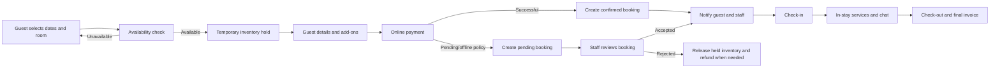

# Tuloy — Hotel Management System Overall Plan

## 1. Product goal

**Tuloy** is a hotel operations and guest-experience platform. Build it with:

- **Tuloy Guest** — Flutter mobile app for guests.
- **Tuloy Staff** — Flutter mobile app for hotel staff and employees.
- **Tuloy Admin** — secure administrator role within the Flutter mobile app for the initial release. A dedicated web dashboard is deferred to a future phase.
- A shared, secure backend API for reservations, payments, messaging, services, and reporting.

The system should support a single hotel at launch but be designed so multiple properties can be added later without rebuilding the core.

## 2. Recommended technology approach

| Area | Recommended choice | Why |
| --- | --- | --- |
| Guest & staff mobile apps | Flutter | One maintainable iOS/Android codebase; strong support for notifications, camera/QR, and real-time UX. |
| Admin application (initial) | Flutter + Dart, role-based admin experience | Keeps the first release mobile-only and allows admins to manage essential hotel operations from the same secure application. |
| Backend | NestJS + TypeScript | Modular API structure, role-based access control, WebSockets, and good long-term maintainability. |
| Primary database | PostgreSQL | Reliable transactions for room inventory, reservations, payments, and reporting; scales well with managed hosting. |
| ORM / migrations | Prisma | Type-safe data access and repeatable database migrations. |
| Cache / background jobs | Redis + BullMQ | Fast availability lookups, rate limiting, queued notifications, receipts, and report generation. |
| Real-time chat/status | WebSockets (Socket.IO) | Live guest–staff chat and immediate booking/status updates. |
| File storage | S3-compatible object storage | Room photos, IDs, payment proofs, service images, and feedback attachments. |
| Payments | Stripe (or a Philippines-supported gateway such as PayMongo/Xendit) | Never store card details; use the provider's hosted/tokenized payment flow. |
| Push notifications | Firebase Cloud Messaging + APNs | Booking, payment, service, and chat alerts. |
| Hosting | AWS / Google Cloud / Azure managed services | Managed PostgreSQL, Redis, storage, logging, backups, and autoscaling. |

### Why PostgreSQL is the best database fit

Use **managed PostgreSQL** as the system of record. A hotel platform needs strict transactions: a room must not be sold twice for the same date, payments must be auditable, and reporting must be accurate. PostgreSQL handles relational data, financial records, date-range queries, JSON for flexible service details, replicas, backups, and horizontal read scaling well.

Use Redis only as a supporting cache/queue; it should not be the source of truth for reservations or payments.

## 3. Users and permissions

| Role | Primary responsibilities |
| --- | --- |
| Guest/User | Register, sign in, check availability, reserve/book, pay, manage stay, request services, chat, and leave feedback. |
| Staff/Employee | Review assigned or pending bookings, accept/decline based on policy, chat with guests, fulfill service requests, and update check-in/check-out/reservation status. |
| Admin | Manage hotels, rooms, rates, bookings, users, staff, services, revenue, analytics, employee leave, roles, and operational settings. |

Implement role-based access control (RBAC) in the backend. Every sensitive action must be authorized server-side; hiding a web or app button alone is not security.

### Languages and localization

Tuloy must support multiple languages from the first release. Start with **English**, **Filipino/Tagalog**, and **Cebuano/Bisaya**, then add languages per hotel market.

- Let guests and staff select their preferred language during onboarding and change it anytime in Settings.
- Automatically use device language when supported, with English as the fallback.
- Translate all app navigation, booking/payment/service flows, notifications, emails, SMS, receipts, validation errors, policies, and staff task statuses.
- Allow each hotel to provide translated service names, descriptions, menus, guides, and promotions in Tuloy Admin. If a translation is unavailable, show the hotel’s default language safely.
- Keep user-entered chat messages in their original language. Add optional “Translate” assistance later; never replace the original text.
- Store currency, dates, times, time zones, number formats, and tax labels in locale-aware formats while retaining standard values in the database.

Use Flutter localization (`intl` and ARB translation files). Use translation keys—not hard-coded screen text—so new languages can be introduced without redesigning the application.

## 4. Core modules

### Guest mobile application

1. **Authentication and profile**
   - Email/phone sign-up and login, password reset, optional social login.
   - Profile, saved guests, booking history, invoices, and notification preferences.
2. **Room discovery and availability**
   - Search by check-in/out dates, guest count, room type, price, amenities, and availability.
   - Room details, photos, policies, inclusions, cancellation terms, and add-ons.
3. **Reservations and bookings**
   - Live inventory check, booking form, confirmation number, booking modification/cancellation rules.
   - Clear state: pending, confirmed, checked in, checked out, cancelled, no-show.
4. **Payments**
   - Deposit/full payment, payment status, receipts, refunds and payment history.
5. **Guest services — one tap away**
   - Restaurant ordering/reservations, room cleaning request, laundry, airport transfer, wellness/grooming, concierge/custom care, amenities, hotel/resto guides, and support.
   - An **Extra services** area lets guests browse and request any hotel-defined add-on, such as late checkout, extra bed, birthday setup, luggage storage, printing, tours, or custom requests.
   - Requests include a status timeline: requested, accepted, in progress, completed/cancelled.
6. **Chat and notifications**
   - Guest-to-hotel/staff chat; order, booking, payment, and service notifications.
7. **Stay experience**
   - Digital hotel guide, feedback/rating, issue reporting, and Wi-Fi connection guidance.
   - When a guest has a valid confirmed/in-house booking, the system creates a time-limited Wi-Fi identity or voucher linked to their reservation. The mobile app can offer one-tap connection and captive-portal login; network access ends automatically after check-out.
   - Full automatic joining depends on iOS/Android permissions and the hotel network hardware. Integrate with the Wi-Fi/captive-portal provider (for example via RADIUS, PMS integration, or its API) and retain a QR code/manual fallback for devices that do not allow silent connection.
8. **QR restaurant ordering**
   - Guests scan a QR code at their restaurant table. The code identifies the hotel, outlet, and table number, then opens the current menu in the mobile app or a secure web fallback.
   - The guest selects food, notes allergies/special instructions, reviews the order, and completes it. The order is automatically created in the restaurant queue with the table number—no staff re-entry is required.
   - Payment can be made in-app, charged to the guest room only after guest verification, or handled under the restaurant's configured payment policy.
9. **Loyalty and points**
   - Show membership tier, current points, available rewards, points history, and expiry date.
   - Award points for eligible room stays, restaurant orders, and selected services; allow points to be redeemed for hotel-defined rewards or discounts.

### Staff mobile application

- Secure staff sign-in and role/location assignment.
- Booking queue and availability decision workflow.
- Guest chat, notifications, and task/service-request queue.
- Check-in, check-out, cancellation, no-show, cleaning, and service fulfillment status updates.
- Shift-friendly dashboard showing assigned work and urgent requests.

### Admin mobile experience (initial release)

- Reservation calendar/list, room inventory, prices, blocked rooms, and occupancy controls.
- Booking approval/override, payment tracking, refund workflow, invoices, and audit trail.
- Daily dashboard: arrivals, departures, in-house guests, pending actions, occupancy, daily balance, and cash/payment reconciliation.
- Revenue/income analytics by day, week, month, room type, service, channel, and payment method.
- Staff management, leave applications and approval status.
- Service catalog management: rooms, restaurant, transfers, amenities, wellness, guides, and cleaning task rules.
- Dynamic extra-service and laundry management: service name, category, description, photos, price/tax, availability, lead time, service hours, capacity, eligible rooms/guests, and fulfillment staff.
- Loyalty configuration: points-per-currency rules, eligible transactions, tiers, rewards, redemption limits, expiry, and manual point adjustments with audit history.
- Feedback analytics and response management.

### Dynamic services model

Services must be data-driven rather than hard-coded into the mobile app. Admins should be able to create, edit, activate, pause, price, schedule, and organize services from the administrator role. The Flutter app loads the active catalog from the API, so a newly added service can appear without publishing a new version.

Each hotel can add any additional service it offers through **Tuloy Admin**. A service stays in Draft until the required information is complete; only then can an authorized admin publish it to Tuloy Guest. This prevents incomplete, unpriced, or unsupported services from being ordered.

### Required details when adding a service

| Detail | Requirement |
| --- | --- |
| Service information | Name, category, short description, detailed instructions, and at least one guest-facing image when appropriate. |
| Language content | Default-language service name/description plus translations for each guest language the hotel enables. |
| Availability | Hotel/property, service hours, days available, lead time, blackout dates, capacity, and estimated completion time. |
| Price and charges | Currency, price model, base price, tax/service charge, options/add-ons, discounts, and whether staff quotation is allowed. |
| Payment | Payment methods accepted: pay now online, charge to room, pay at outlet/delivery, or no charge. Room charge is available only to verified eligible guests. |
| Order information | Required guest inputs such as quantity, preferred schedule, pickup/delivery location, special instructions, allergy/safety notice, or attachment. |
| Fulfillment | Responsible department/staff, acceptance rule (automatic or staff approval), service status steps, cancellation policy, and escalation contact. |
| Points and policy | Whether the service earns/redeems loyalty points, terms, refund policy, and guest eligibility rules. |

Tuloy Admin validates these fields before publishing. Price changes, temporary unavailability, capacity, and payment options can be updated later without changing the mobile application. Existing guest orders preserve a snapshot of the service name, selected options, price, tax, and policy at the time of order.

Each service supports:

- category (for example: Laundry, Dining, Transport, Wellness, Extra Service)
- price model: fixed, per item, per person, per night, or staff quotation
- options/add-ons (for example, wash & fold, express laundry, ironing, fragrance)
- availability hours, blackout dates, capacity, and estimated completion time
- required guest inputs such as pickup time, special instructions, photos, quantities, or delivery location
- assignment rules and live fulfillment statuses

For laundry, the guest selects items/quantity, pickup slot, delivery preference, and special instructions. Staff receive a task, update pickup/processing/delivery stages, and the final charge is added to the guest invoice or paid in-app.

### Restaurant QR ordering safeguards

Each table receives a unique, signed QR code generated by the system. The QR payload should contain only an opaque token—not plain guest, order, or payment information. The backend resolves the token to the active restaurant outlet and table, verifies that it is enabled, and records all submitted orders.

- Load menu, price, item availability, tax, service charge, and promotions dynamically from the admin dashboard/POS integration.
- Require the guest to review and explicitly submit the cart before an order reaches the kitchen; this prevents unintended orders from a scan.
- Show the table number prominently, permit a staff correction workflow, and prevent reusing invalid or retired QR tokens.
- Send new orders directly to the kitchen display/POS where available; otherwise show them in the staff restaurant order queue.

### Loyalty points rules

Use a ledger, not only a changing points balance. Each earn, adjustment, expiration, and redemption becomes an immutable `loyalty_point_transaction` tied to a guest and, where applicable, to a reservation/payment/service request. This gives guests and admins a trustworthy history and prevents reporting disputes.

Suggested first-release rules:

- Award points only after a completed stay or completed paid service.
- Reverse pending/awarded points when an eligible payment is refunded.
- Let admins configure earning and redemption rates by hotel and campaign.
- Apply redemption limits per booking and prohibit redeeming more than the payable eligible amount.
- Offer simple tiers later (for example, Member, Silver, Gold) after the base points ledger is stable.

## 5. Key booking workflow



Important rule: availability must be validated again inside a database transaction when the booking is created. Use a short-lived room hold during checkout to prevent concurrent guests from booking the same room.

## 6. Essential data model

Main entities:

- `users`, `roles`, `staff_profiles`, `employee_leave_requests`
- `hotels`, `room_types`, `rooms`, `amenities`, `room_rate_plans`, `room_availability_blocks`
- `guests`, `reservations`, `reservation_rooms`, `reservation_guests`, `booking_status_history`
- `payments`, `refunds`, `invoices`, `payment_provider_events`
- `service_categories`, `services`, `service_requests`, `service_request_status_history`
- `service_options`, `service_option_values`, `service_availability_rules`, `service_staff_assignments`, `service_prices`
- `service_payment_methods`, `service_order_field_definitions`, `service_policy_versions`, `service_order_price_snapshots`
- `restaurant_menus`, `restaurant_orders` (if restaurant ordering is in scope)
- `restaurant_outlets`, `restaurant_tables`, `restaurant_table_qr_tokens`, `restaurant_order_items`, `restaurant_order_status_history`
- `loyalty_accounts`, `loyalty_tiers`, `loyalty_rewards`, `loyalty_point_transactions`, `loyalty_redemptions`
- `wifi_access_credentials`, `wifi_access_events`, `wifi_provider_sync_events`
- `notification_templates`, `notification_preferences`, `notification_deliveries`
- `supported_locales`, `hotel_locales`, `user_locale_preferences`, `translated_content`
- `conversations`, `messages`, `message_attachments`
- `feedback`, `notifications`, `audit_logs`

Every hotel-owned record should contain `hotel_id`, even for a first release. This keeps the platform ready for multiple branches/properties.

## 7. APIs and integrations

- REST API for standard app/dashboard operations; WebSockets for chat and live updates.
- Payment-provider webhooks to confirm payment server-to-server.
- Email and SMS provider for receipts, verification, booking confirmations, payment changes, check-in/out reminders, and important service updates.
- Push notifications for operational and guest alerts. All important events should be delivered through a unified notification service that selects push, email, and/or SMS using the event severity, user preferences, and verified contact methods.
- Optional later integrations: property-management system (PMS), accounting software, door locks, POS/kitchen display, channel manager, and Wi-Fi/captive portal.

### Notification policy

| Event | Push | Email | SMS |
| --- | --- | --- | --- |
| Account verification / password reset | Optional | Yes | Optional (OTP) |
| Booking confirmation or cancellation | Yes | Yes | Yes for urgent changes |
| Payment receipt/refund | Yes | Yes | Optional |
| Upcoming check-in/check-out reminder | Yes | Yes | Optional |
| Guest chat/service update | Yes | Optional | No by default |
| Critical arrival/booking change | Yes | Yes | Yes |

Use queued delivery with retries, provider delivery-status webhooks, opt-in/opt-out preferences, templates per hotel/brand, and an audit log. SMS should be reserved for critical or opted-in messages because it has cost and compliance implications.

## 8. Security, privacy, and reliability

- JWT access tokens with refresh-token rotation; hashed passwords; optional MFA for admins.
- RBAC, server-side authorization, audit logs, rate limiting, input validation, and encrypted secrets.
- Store only payment-provider tokens/identifiers, never raw card data.
- Encrypt sensitive data in transit (HTTPS) and at rest; define retention/deletion procedures for guest data.
- Automated backups, point-in-time recovery, monitoring, error reporting, and tested restore procedures.
- Idempotency keys for payment and booking requests to prevent duplicate charges/reservations.

## 9. Delivery plan

### Phase 0 — Discovery and UX (1–2 weeks)

- Confirm booking policies, payment methods, cancellation/refund rules, approval rules, room/rate types, service catalog, and hotel operations.
- Create user flows, wireframes, design system, database schema, and API contract.

### Phase 1 — MVP booking platform (6–10 weeks)

- Authentication, roles, profiles, rooms, availability search, booking/reservation workflow.
- Online payments, email/SMS/push booking notifications, staff booking queue, admin booking/room dashboard.
- Basic revenue/daily-status dashboard and deployment foundation.

### Phase 2 — Hotel operations (4–6 weeks)

- Guest/staff chat, check-in/out workflow, dynamic service catalog, laundry workflow, extra services, room cleaning tasks, feedback, staff leave applications.
- Expanded analytics, invoices/refunds, audit logs, and operational reporting.

### Phase 3 — Experience and integrations (ongoing)

- Loyalty points/rewards and membership tiers, QR restaurant ordering/POS integration, airport transfer, wellness/grooming, digital guides, and reservation-linked Wi-Fi/captive-portal integration.
- PMS/POS/channel-manager/door-lock integrations, multi-property support, loyalty, and advanced forecasting.

Timelines assume a small product team and are refined after requirements/design are agreed.

## 10. Suggested team

This senior team owns the product from strategy through launch and scale. The Product Owner is the single priority decision-maker; all other leads work from the same roadmap, measurable outcomes, and release plan.

| Role | Primary ownership | Key deliverables |
| --- | --- | --- |
| **Product Owner** | Hotel operations requirements, roadmap, budget and priorities | Product vision, MVP scope, service/payment policies, backlog, acceptance criteria, pilot feedback decisions, KPI targets. |
| **Senior Developer** | Technical direction and delivery | Clean Architecture, API/data model, Flutter/NestJS implementation, code review, integrations, security standards, and technical roadmap. Recommended: lead one backend/full-stack senior supported by Flutter developers. |
| **Senior Designer** | Guest and staff experience, brand consistency | Design system, user research, wireframes, prototypes, accessibility, mobile/web UI specifications, and usability testing. |
| **Senior Quality Assurance** | Product and release quality | Test strategy, booking/payment/service test cases, automation, device/browser coverage, regression testing, release sign-off, defect metrics. |
| **Senior Marketing** | Go-to-market and growth | Brand positioning, launch campaign, content, app-store listings, hotel onboarding materials, acquisition, loyalty communication, and marketing analytics. |
| **DevOps Engineer** | Reliable and secure operations | Cloud infrastructure, CI/CD, environments, observability, backups/restore drills, access control, incident response, scalability and cost monitoring. |

### Recommended delivery pod

For the MVP, add these implementation roles under the senior leads:

- 1 Flutter developer for Tuloy Guest and Tuloy Staff
- 1 additional Flutter developer as needed for the Admin, Staff, and Guest role experiences
- 1 Backend developer for NestJS, PostgreSQL, payments, integrations, and real-time services
- 1 QA engineer (full-time from the first integrated booking/payment release)

The Senior Developer leads the engineering pod; the Senior Designer and Senior QA work continuously with it, not only at the end of development.

## 11. Recommended server and technology stack

### Recommended production platform: AWS

AWS is recommended for Tuloy because it supports a gradual path from one hotel to a multi-property platform without changing the core architecture. Use managed services instead of maintaining virtual servers manually.

| Layer | Recommended service / technology | Tuloy purpose |
| --- | --- | --- |
| Mobile | Flutter + Dart | Tuloy Guest and Tuloy Staff for iOS/Android. |
| Admin/Staff/Guest UI | Flutter + Dart | One mobile application with role-based experiences for Tuloy Guest, Staff, and Admin. |
| API | NestJS + TypeScript, Docker | Secure modular API, WebSockets, business workflows, integrations. |
| Application runtime | AWS ECS on Fargate | Runs API, workers, and scheduled jobs in containers without managing servers. |
| Database | Amazon RDS for PostgreSQL | Transactional source of truth for rooms, bookings, payments, orders, services, and loyalty. |
| High availability | RDS Multi-AZ; read replica/cluster scale-up when needed | Failover and reporting/read capacity as properties and traffic grow. |
| Cache and jobs | Amazon ElastiCache for Redis/Valkey + BullMQ | Availability cache, rate limiting, chat presence, queues, retries, notifications, reports. |
| Files | Amazon S3 + CloudFront | Room/service images, invoices, attachments, secure document storage and fast delivery. |
| Edge/security | Route 53, Application Load Balancer, AWS WAF, ACM | DNS, HTTPS, load balancing, and web/API protection. |
| Secrets and identity | AWS Secrets Manager; backend RBAC/JWT | Secure credentials, key rotation, staff/admin authorization. |
| Monitoring | CloudWatch + Sentry | Logs, alerts, error tracking, performance monitoring, and incident diagnosis. |
| Delivery | GitHub, GitHub Actions, Amazon ECR, ECS deployments | Automated testing, image builds, staging deployment, production releases and rollback. |

### Environment and scale path

| Stage | Server setup | When to move forward |
| --- | --- | --- |
| Development | Local Docker, shared development database with non-production data | Daily development and feature work. |
| Staging | Separate AWS account/environment, small Fargate services, managed PostgreSQL, test payment gateway | Required for every release, POS/Wi-Fi integration testing, and QA sign-off. |
| Pilot / one hotel | Two API tasks across availability zones where budget permits, RDS PostgreSQL with backups, Redis, S3, CloudFront, alarms | Before real bookings and payments are accepted. |
| Multi-property / growth | Autoscaling Fargate, RDS Multi-AZ/read scaling, Redis scaling, CDN/WAF, warehouse/BI for analytics | Multiple hotels, high booking volume, or strict uptime/reporting requirements. |

Start with RDS PostgreSQL as the transaction database and keep `hotel_id` on all hotel-owned records. Do not split into microservices too early: start with a modular NestJS application, then extract independently scaling workloads (notifications, reporting, integrations) only when operational data proves the need.

### Free and low-cost services for development and pilot

Use free services during prototyping, internal testing, demos, and a small pilot to reduce initial cost. Treat free tiers as a starting point—not a guarantee for a live hotel business—because limits, paused projects, support, backups, and terms can change.

| Need | Free/low-cost starting choice | Production upgrade trigger |
| --- | --- | --- |
| Database, authentication, storage, realtime chat | **Supabase Free** (PostgreSQL, Auth, Storage, Realtime) | Upgrade to Supabase paid or AWS RDS/S3 when uptime, project-pausing risk, backups, storage, or usage needs exceed free-tier limits. |
| API/backend during development | Local Docker + NestJS; deploy a limited pilot backend to a free/low-cost container/serverless provider | Move booking/payment production workloads to AWS ECS Fargate before significant real transactions or multiple hotels. |
| Future web preview | Not in initial scope | Introduce only after the mobile release is stable and a genuine desktop-admin need is confirmed. |
| Images and attachments | Supabase Storage first; Cloudflare R2 free allowance if object storage is separated | Move to S3/CloudFront when assets, delivery volume, access controls, or lifecycle policy grows. |
| Push notifications | Firebase Cloud Messaging (FCM) | FCM remains suitable; add production monitoring and notification queue/retry controls. |
| Error monitoring | Sentry free developer tier | Upgrade when team, event, alerting, or retention requirements grow. |
| Email/SMS | Use sandbox/test modes during development | Production email/SMS and sender verification are paid operational services; budget for them before launch. |

**Important:** do not run a real hotel’s payments, irreversible reservations, or guest personal data solely on free services without a backup, monitoring, access-control, incident, and recovery plan. Payment gateways, SMS, App Store/Google Play publishing, domains, and reliable production hosting can incur costs even if the development stack is free.

## 12. Operating model: product, implementation, marketing, and scalability in sync

| Cadence | Product Owner | Development / Design / QA / DevOps | Marketing | Outcome |
| --- | --- | --- | --- | --- |
| Quarterly | Sets hotel/business objectives and prioritizes roadmap | Estimates capacity, identifies technical risks and scale work | Defines launch/growth campaigns and target segments | One approved quarterly roadmap and KPI set. |
| Every two weeks | Refines priorities and accepts completed work | Designs, builds, tests, deploys to staging, and demos increment | Prepares content, onboarding, campaign assets, and in-app messaging | A shippable, tested increment aligned with campaign timing. |
| Before release | Confirms policy and business readiness | QA sign-off, security/backup checks, performance testing, rollback plan | Finalizes communications, app-store/website updates, support scripts | Go/no-go decision using one release checklist. |
| After release | Reviews guest/staff outcomes | Monitors errors, latency, booking/payment success and incidents | Measures acquisition, activation, conversion, retention, and loyalty engagement | Data-driven iteration; no feature is “done” until measured. |

### Shared success metrics

- Booking conversion, payment success rate, booking error/duplicate-booking rate, and cancellation rate
- Occupancy, average daily rate, revenue per available room, service/restaurant revenue, and daily balance accuracy
- Service acceptance time, completion time, guest satisfaction, chat response time, and QR-order completion rate
- App activation, monthly active guests, retention, loyalty enrollment/redemption, and campaign conversion
- API availability, response time, release failure rate, recovery time, backup-restore success, and cloud cost per booking/property

### Implementation governance

1. The Product Owner writes the problem, business rule, KPI, and acceptance criteria.
2. The Senior Designer validates the flow with prototypes before expensive build work.
3. The Senior Developer approves technical design, security, data ownership, and integration approach.
4. QA creates tests alongside the requirement; DevOps confirms observability, deployment, and recovery requirements.
5. Marketing prepares the positioning and guest communication before the feature is released.
6. Release only when feature, operations, support, analytics, and marketing are ready together.

## 13. MVP acceptance criteria

The MVP is ready for pilot use when:

- Guests can create an account, find a room for dates, reserve/book, pay, and receive confirmation.
- Staff can safely review bookings, communicate with guests, and update the stay outcome.
- Admins can manage room availability, view every reservation/payment, see daily operational status, and view income totals.
- Duplicate bookings are prevented under simultaneous checkout attempts.
- Payment webhooks, notifications, access control, audit logging, backups, and monitoring are operating in production.

## 14. Mobile experience and visual design

The mobile experience should feel premium and welcoming without overwhelming guests. The design should emphasize the next useful action—book a room, manage an upcoming stay, or request a service—rather than exposing every feature at once.

### Design principles

- **Calm, hotel-first visual language:** generous whitespace, high-quality room/service images, refined typography, rounded cards, and a restrained color palette aligned to the hotel brand.
- **Simple navigation:** a bottom navigation bar with Home, Explore, My Stay, Messages, and Profile. Contextual actions stay on each screen instead of being hidden in complex menus.
- **Progressive disclosure:** show only essential booking fields first; reveal filters, service options, and policy details when requested.
- **Fast confidence cues:** visible availability, total price, confirmation state, payment status, service ETA, and task timeline.
- **Delight with purpose:** subtle motion, clear empty states, personalized greetings, loyalty progress, and well-timed service suggestions—never distracting animations.
- **Accessible by default:** readable text, strong color contrast, large tap targets, screen-reader labels, and simple language.
- **Language-aware by default:** familiar English, Filipino/Tagalog, or Cebuano/Bisaya wording; allow immediate language switching without losing booking or order progress.

### Suggested mobile home screen

1. Welcome card with upcoming stay or a prominent “Find a room” action.
2. Date/guest search for new bookings.
3. “Services at your stay” cards: Laundry, Room Cleaning, Dining, Airport Transfer, Wellness, and Extra Services.
4. Current service requests with live status and staff chat shortcut.
5. Loyalty card showing points, tier, and a simple next-reward progress indicator.
6. Hotel guides and contextual offers at the bottom.

### Key screen standards

- Booking checkout uses a short, step-by-step flow with a persistent price summary.
- Service cards show starting price or “request quote,” estimated time, availability, and one clear call to action.
- A service detail page supports options and instructions without making the guest leave the flow.
- The “My Stay” screen brings booking, invoice, room details, service requests, Wi-Fi help, and support together.
- Staff screens prioritize queues, urgency, status updates, and fast guest communication over promotional visuals.
- Restaurant QR flow should be extremely short: scan → menu/table confirmation → cart → submit → live preparation status.

## 15. Decisions to finalize before development

1. Single hotel or multiple properties at launch?
2. Instant confirmation versus staff approval for each booking?
3. Accepted payment methods and country/currency (for example, card, GCash, bank transfer)?
4. Cancellation, deposit, refund, and no-show policies?
5. Does the restaurant need table reservation, room delivery, ordering/payment, or all three?
6. Which existing systems must integrate (PMS, POS, accounting, Wi-Fi, locks, channel manager)?
7. Which staff roles and approval limits are needed?
8. Which services are available at launch, and which need staff approval versus instant request acceptance?
9. What is the loyalty earning rate, redemption value, expiry policy, and tier strategy?
10. Which Wi-Fi/captive-portal equipment/provider is installed, and does it offer API, RADIUS, or PMS integration?
11. Which restaurant POS/kitchen-display system is used, if any, and should QR orders be room-charged, paid immediately, or both?
12. Which SMS/email providers and sender identities are approved for the hotel’s operating country?
13. Which languages must each hotel support at launch, and who approves translations for hotel policies, menus, and services?

## 16. First implementation recommendation

Start with **one Flutter mobile application** containing role-based **Guest**, **Staff**, and **Admin** experiences, plus a **NestJS + PostgreSQL backend**. Do not develop the web dashboard in the initial release. Release booking, payments, reservation operations, dynamic service requests, and daily reporting first. Add the loyalty program after payment and invoice reconciliation is stable.

## 17. Development breakdown — Mobile application only (initial release)

The backend, database, authentication, and design system begin before the first mobile screen. The initial user-facing product is one role-based **Tuloy Flutter mobile application**. Web development is out of scope until the mobile release is stable.

### Part A — Tuloy mobile application (Flutter)

Build one Flutter codebase with separate, secure experiences for **Tuloy Guest**, **Tuloy Staff**, and **Tuloy Admin**. A user’s role determines the screens and actions they can access.

#### A0. Clean Architecture (required)

Use Clean Architecture with feature-first modules. Business rules must not depend on Flutter widgets, external APIs, Supabase, AWS, payment SDKs, or database details.

```text
lib/
  core/                 # errors, result types, DI, theme, localization, security helpers
  features/
    booking/
      domain/           # entities, repository contracts, use cases
      data/             # DTOs, API/local data sources, repository implementations
      presentation/     # pages, widgets, state controllers (Bloc/Riverpod)
    services/  payments/  chat/  loyalty/  restaurant/  wifi/  admin/
  app/                  # routing, role guards, app bootstrap
```

- **Domain**: pure Dart entities and use cases such as `CheckAvailability`, `CreateBooking`, `SubmitServiceRequest`, and `UpdateStayStatus`.
- **Data**: API, cache, payment, QR, push, and Wi-Fi adapters; map external DTOs into domain entities.
- **Presentation**: Flutter screens and state only; never place booking/payment rules inside widgets.
- Inject dependencies through interfaces; test domain use cases without Flutter or network access; test data adapters separately; run widget/integration tests for critical flows.

#### A1. Shared mobile foundation

- English, Filipino/Tagalog, and Cebuano/Bisaya language selection and locale-aware formatting.
- Sign-up, login, password reset, profile, secure session, notification preferences, and role-based access.
- Design system: colors, typography, cards, buttons, forms, loading/empty/error states, accessibility, and offline-friendly behavior for unstable hotel connectivity.
- Push notifications, deep links, analytics events, secure API client, image/file upload, and in-app update/error reporting.

#### A2. Tuloy Guest — MVP screens and features

| Area | Guest capability |
| --- | --- |
| Home | Upcoming stay or “Find a room,” key hotel services, loyalty summary, and important notifications. |
| Find & book | Date/guest search, room availability, filters, room details, add-ons, price breakdown, booking policy, checkout, and confirmation. |
| Payments | Deposit/full payment, payment methods, payment processing state, receipt/invoice, refund status. |
| My Stay | Booking status, room details, check-in/out information, invoice, hotel guide, Wi-Fi access help, support and feedback. |
| Services | Dynamic catalog; laundry, cleaning, dining, transfers, wellness, amenities, and hotel-added extra services with options, pricing, payment, and live request status. |
| Restaurant QR | Scan a table QR, display table-confirmed live menu, cart, special instructions, submit order, and view order status. |
| Messages | Secure guest-to-staff chat, attachments where permitted, service/booking context, and notification shortcut. |
| Loyalty | Points balance/history, rewards, tier, earn/redeem rules, and redemption during eligible checkout. |
| Profile | Preferred language, contact details, saved guests, notification settings, privacy settings, and booking history. |

#### A3. Tuloy Staff — MVP screens and features

| Area | Staff capability |
| --- | --- |
| Work dashboard | Today’s arrivals/departures, pending reservations, unread chats, urgent service tasks, and assigned workload. |
| Reservations | Search/view bookings, check availability, accept or decline based on permission, and add internal notes. |
| Guest stay | Update check-in, in-house, check-out, cancelled, and no-show status; record the status history. |
| Service tasks | Accept, assign, start, complete, or escalate laundry, room cleaning, restaurant, transfer, and custom service requests. |
| Restaurant orders | View QR orders by outlet/table, send or track kitchen status, and resolve table/order issues. |
| Guest chat | Respond to guests with booking/service context and approved reply templates. |
| Notifications | Booking assignments, service alerts, shift reminders, and operational messages. |

#### A4. Mobile delivery sequence

1. App foundation, authentication, language support, room catalog, availability, and booking UI.
2. Payment checkout, booking confirmation, notifications, My Stay, and guest profile.
3. Staff reservation queue, booking status actions, check-in/out, and guest chat.
4. Dynamic services, laundry, cleaning tasks, QR restaurant ordering, and payment/room-charge rules.
5. Loyalty, Wi-Fi/captive-portal integration, advanced service integrations, and performance/accessibility refinement.

### Part B — Deferred future: Tuloy Admin web dashboard

Do **not** build this in the initial scope. Reconsider a web dashboard only after the mobile release is stable and administrators need complex desktop reporting, bulk edits, or long-form configuration. The API and PostgreSQL model should remain web-ready, but no Next.js development is planned now.

#### B1. Admin web modules

| Module | Admin capability |
| --- | --- |
| Overview dashboard | Daily arrivals/departures, occupied rooms, pending bookings, service load, revenue, balance, and operational alerts. |
| Hotels, rooms & rates | Manage properties, room types, rooms, photos, amenities, rates, inventory blocks, and availability rules. |
| Reservations & payments | Booking calendar/list, payment/refund records, invoices, cancellations, adjustments, and audit trail. |
| Dynamic services | Add/edit/publish/pause any hotel service, required details, price, payment methods, languages, hours, capacity, staff assignment, and policies. |
| Restaurant | Manage outlets, tables, signed QR codes, menus, item availability, orders, and POS/kitchen integration. |
| Staff & leave | Staff accounts, roles, departments, shifts/assignments where needed, leave applications, and approvals. |
| Guests & loyalty | Guest profiles, booking history, points ledger, rewards, tier rules, and authorized point adjustments. |
| Messages & feedback | Conversation oversight, escalation, feedback trends, and service-recovery workflows. |
| Marketing & content | Promotions, banners, guides, service images, notification templates, loyalty campaigns, and multilingual content. |
| Analytics & reports | Occupancy, income, balance, bookings, payments, services, restaurant sales, loyalty, staff performance, exports, and scheduled reports. |
| Settings & integrations | Hotel policies, taxes, payment gateways, email/SMS/push settings, Wi-Fi, POS, PMS, roles, audit logs, and API/webhook status. |

#### B2. Future web delivery sequence (not part of initial scope)

1. Admin login/roles, hotel setup, rooms/rates/inventory, reservations, and payment visibility.
2. Daily dashboard, booking calendar, staff accounts, status/audit history, and reports.
3. Dynamic service builder, laundry/cleaning controls, notifications, guest/service oversight, and feedback.
4. Restaurant QR/menu/order administration, loyalty controls, multilingual content, marketing campaigns, and external integrations.

### Mobile-only operating rule

All Guest, Staff, and Admin actions use the **same backend and source-of-truth data**. A service created or paused by an Admin changes what guests can request immediately; a booking, payment, chat, QR order, or staff status update appears to authorized mobile users in real time. WebSocket events refresh urgent operational views, while all financial and booking changes remain transactionally recorded in PostgreSQL.
